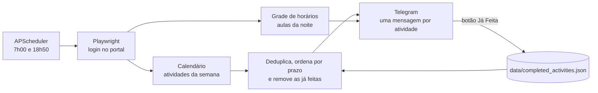

# UVV Portal Monitor

Bot que entra no portal do aluno da UVV todo dia, encontra as atividades com prazo próximo e me avisa no Telegram, junto com as aulas da noite. Roda 24/7 como daemon numa VPS da Oracle Cloud.

## Por que existe

Perdi uma atividade de **3 pontos** porque ela foi publicada no calendário do portal e eu não vi a tempo. Construí este bot para que isso não se repita.

## O que ele faz

- **Às 7h:** faz login no portal, abre o calendário e lê as atividades da semana. Para cada uma, envia ao Telegram o título, a disciplina, o vencimento, quanto tempo falta, um trecho do enunciado e os links dos anexos.
- **Às 18h50:** lê a grade de horários e envia as disciplinas, salas e professores do 1º e do 2º tempo da noite.
- **Botões em cada atividade:** "✅ Já Feita" grava a atividade como concluída, e ela para de aparecer nos próximos resumos; "❌ Ignorar" só arquiva a mensagem.
- **Ordena por urgência** e remove duplicatas: a mesma atividade aparece em vários dias do calendário, mas chega uma vez só.



## Decisões técnicas

| Problema | Solução |
|---|---|
| O HTML do calendário muda e quebra o scraping | Lê o JSON da própria API do portal (`/Calendario/ObterPostagem`), interceptado com `page.expect_response` no clique do card; o HTML do modal fica como plano B |
| Seletores mudam de uma versão do portal para outra | Cada elemento (login, célula de hoje, cards) tem uma lista de seletores alternativos em `config.py` |
| Login falha por lentidão do portal | Até 3 tentativas, com screenshot de diagnóstico a cada falha e reautenticação quando a sessão expira |
| Avisos do portal cobrem o calendário e bloqueiam o clique | O bot fecha os modais de comunicado antes de abrir cada atividade |
| Mesma atividade em vários dias do calendário | Chave normalizada `título + disciplina + vencimento` para deduplicar e marcar como feita |
| Precisa rodar sem eu ligar o computador | Modo `--daemon` com APScheduler e polling do Telegram no mesmo loop `asyncio`, numa VPS gratuita |

## Stack

Python 3 · Playwright (Chromium headless) · python-telegram-bot 20 · APScheduler · Pydantic Settings · Oracle Cloud (VPS)

## Estrutura

```
main.py                    # entrada: --daemon, --run-morning, --run-evening
config.py                  # variáveis de ambiente, horários e seletores
src/scraper/client.py      # navegador e login com retentativas
src/scraper/activities.py  # calendário, prazos e deduplicação
src/scraper/schedule.py    # aulas da noite
src/scraper/attachment_handler.py  # links dos anexos
src/scraper/completed_store.py     # atividades marcadas como feitas
src/scheduler/job_scheduler.py     # rotinas das 7h e 18h50
src/bot/telegram_bot.py    # mensagens e botões
```

## Como rodar

```bash
git clone https://github.com/Uugaren/uvv-portal-monitor.git
cd uvv-portal-monitor
python -m venv venv && source venv/bin/activate   # Windows: venv\Scripts\activate
pip install -r requirements.txt
playwright install chromium
cp .env.example .env   # preencha com seus dados
```

No `.env`, coloque seu usuário e senha do portal, o token de um bot criado no [@BotFather](https://t.me/BotFather) e o seu chat ID do Telegram.

```bash
python main.py --run-morning   # testa a rotina das 7h agora
python main.py --run-evening   # testa a rotina das 18h50 agora
python main.py --daemon        # modo contínuo (padrão)
```

Para manter rodando numa VPS Linux, um serviço `systemd` resolve:

```ini
# /etc/systemd/system/uvv-monitor.service
[Unit]
Description=UVV Portal Monitor
After=network-online.target

[Service]
WorkingDirectory=/home/ubuntu/uvv-portal-monitor
ExecStart=/home/ubuntu/uvv-portal-monitor/venv/bin/python main.py --daemon
Restart=always

[Install]
WantedBy=multi-user.target
```

## Segurança

Suas credenciais ficam só no `.env`, que está no `.gitignore`. O bot só responde ao `TELEGRAM_CHAT_ID` configurado e só lê o portal: não envia, edita nem entrega nada.

## Próximos passos

- Aviso extra na véspera do vencimento, não só no resumo da manhã
- Guardar as atividades no SQLite para os botões funcionarem depois de reiniciar o bot
- Testes automatizados do parser com páginas salvas do portal

---

Feito por [Arthur Alves Rocha](https://github.com/Uugaren) · Ciência da Computação (UVV) · [jarentech.com.br](https://jarentech.com.br)
